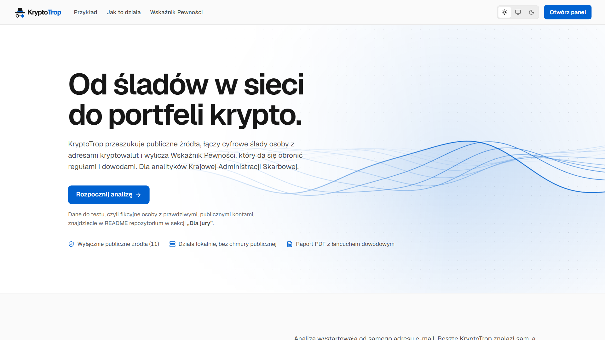
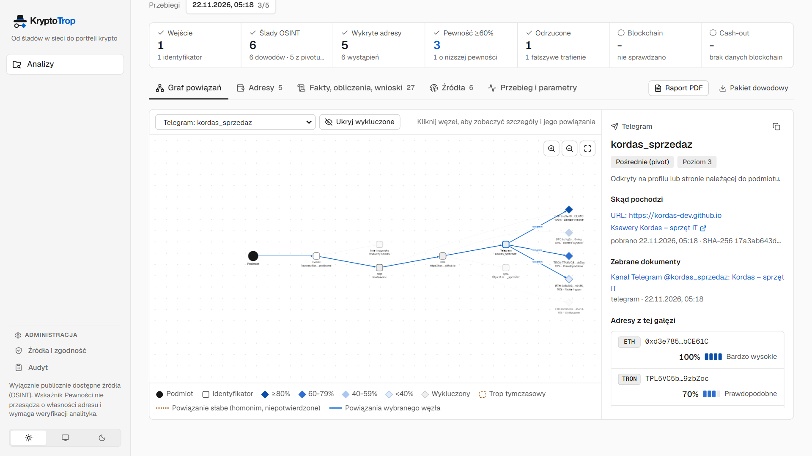
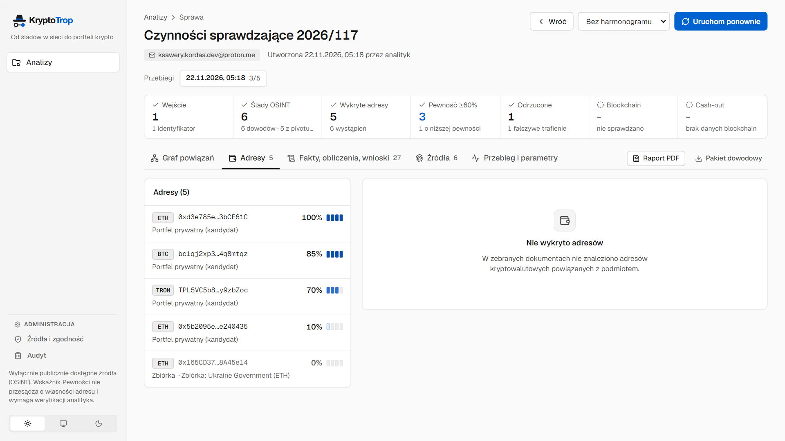
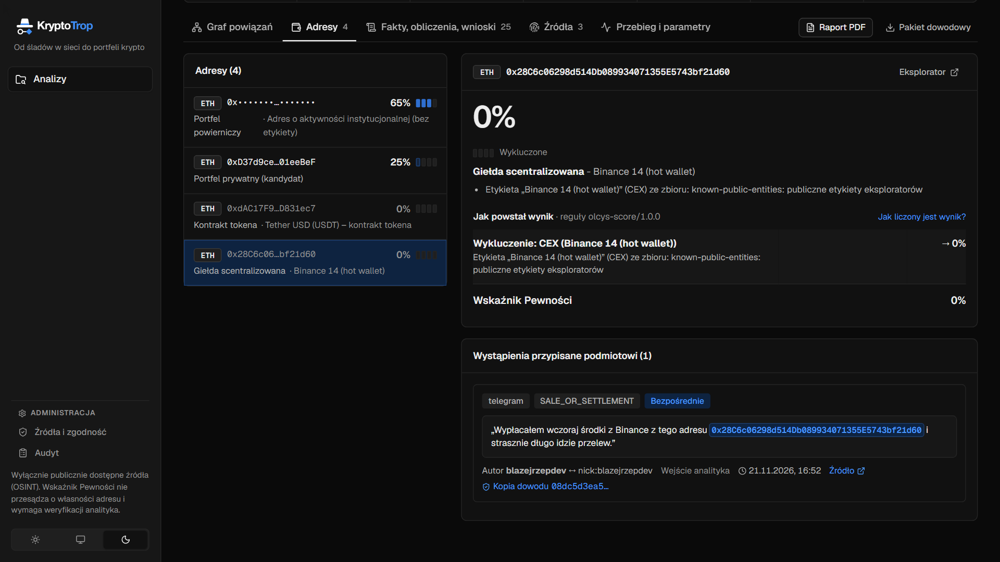
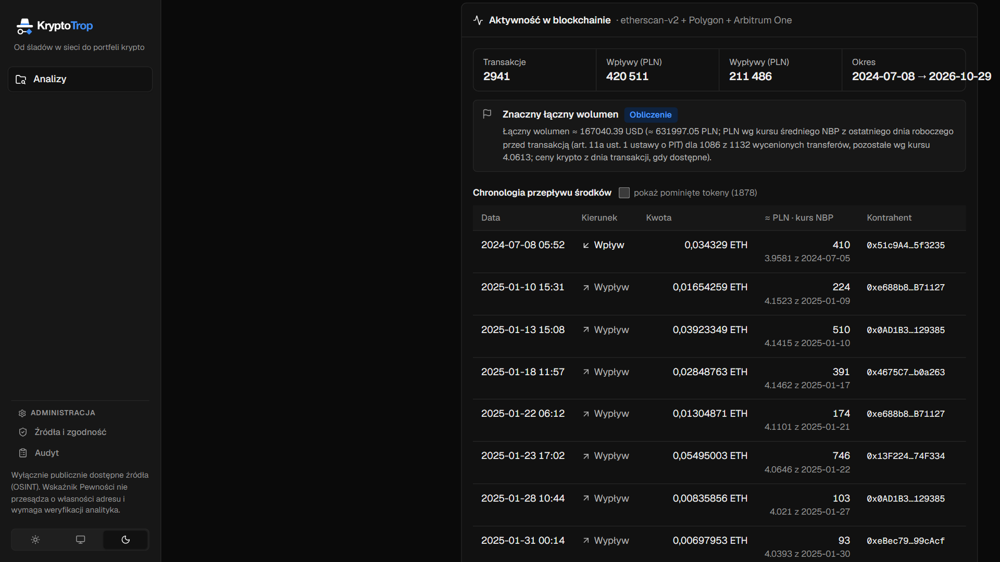
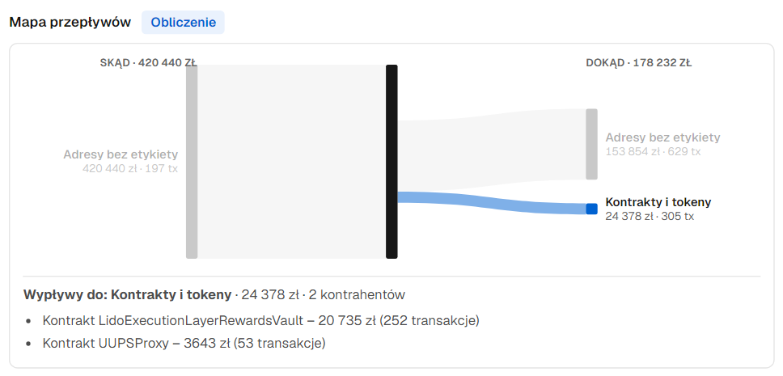
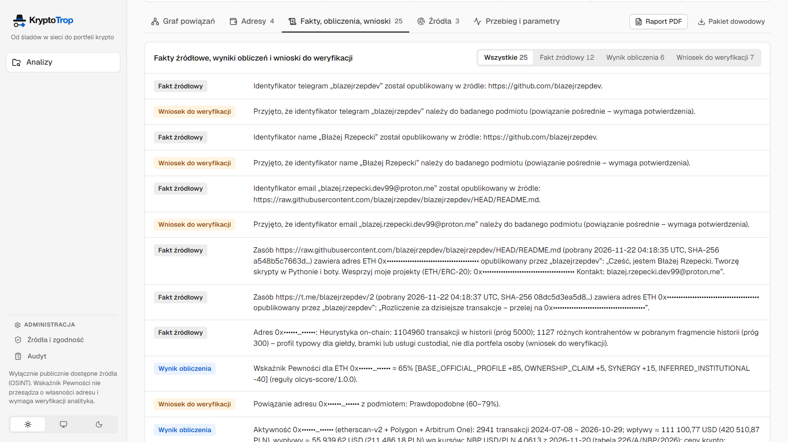

<a id="readme-top"></a>

[![TypeScript][typescript-shield]][typescript-url]
[![Node.js][node-shield]][node-url]
[![Fastify][fastify-shield]][fastify-url]
[![React][react-shield]][react-url]
[![PostgreSQL][postgres-shield]][postgres-url]
[![Docker][docker-shield]][docker-url]
[![HackNation][hacknation-shield]][hacknation-url]

<br />
<div align="center">
  <h2 align="center">🔎 KryptoTrop – od śladów w sieci do portfeli krypto</h2>
  <p align="center">
    Narzędzie OSINT łączące publiczne ślady cyfrowe (Web2) z adresami kryptowalutowymi (Web3) – z wyjaśnialnym Wskaźnikiem Pewności i wykrywaniem wyjścia do walut tradycyjnych.
    <br />
    HackNation 2026 · zadanie Ministerstwa Finansów / KAS „OŁCyŚ”
    <br />
    <a href="https://github.com/opietrzko/olcys/issues">Zgłoś błąd</a>
    &middot;
    <a href="https://github.com/opietrzko/olcys/issues">Zaproponuj funkcję</a>
  </p>
</div>

---

<details>
  <summary>Spis treści</summary>
  <ol>
    <li><a href="#o-projekcie">O projekcie</a></li>
    <li><a href="#założenia">Założenia</a></li>
    <li><a href="#architektura">Architektura</a></li>
    <li><a href="#zbudowane-z">Zbudowane z</a></li>
    <li>
      <a href="#pierwsze-kroki">Pierwsze kroki</a>
      <ul>
        <li><a href="#wymagania">Wymagania</a></li>
        <li><a href="#instalacja">Instalacja</a></li>
      </ul>
    </li>
    <li><a href="#użycie">Użycie</a></li>
    <li><a href="#parametry-wyszukiwania">Parametry wyszukiwania</a></li>
    <li><a href="#źródła-danych">Źródła danych</a></li>
    <li><a href="#wskaźnik-pewności">Wskaźnik Pewności</a></li>
    <li><a href="#wskaźniki-wyjścia-do-fiat">Wskaźniki wyjścia do fiat</a></li>
    <li><a href="#testy">Testy</a></li>
    <li><a href="#zmienne-środowiskowe">Zmienne środowiskowe</a></li>
    <li><a href="#bezpieczeństwo-i-zgodność">Bezpieczeństwo i zgodność</a></li>
    <li><a href="#licencje-komponentów">Licencje komponentów</a></li>
    <li><a href="#dalszy-rozwój">Dalszy rozwój</a></li>
    <li><a href="#licencja">Licencja</a></li>
    <li><a href="#kontakt">Kontakt</a></li>
  </ol>
</details>

---

> **Dla jury: instrukcja testowania.** Krok po kroku: trzy identyfikatory do wpisania i wyniki, które powinny się pojawić, w podziale na etapy obowiązkowego scenariusza: [`docs/scenariusze-testowe.md`](docs/scenariusze-testowe.md).

## O projekcie

Podatnicy publikują adresy portfeli na forach, w ogłoszeniach P2P, na profilach programistycznych i w komunikatorach. Ręczne łączenie tych śladów z historią transakcji jest czasochłonne i trudne do powtórzenia.

KryptoTrop automatyzuje tę pracę dla analityków **Krajowej Administracji Skarbowej**. Na podstawie co najmniej jednego identyfikatora (nick, e-mail, telefon, Telegram, imię i nazwisko, URL, adres krypto) przeszukuje publiczne źródła Internetu, wyodrębnia adresy kryptowalutowe i liczy, jak bardzo prawdopodobne jest, że adres należy do badanej osoby. Wynikiem jest raport z pełnym łańcuchem dowodowym.

**Kluczowe możliwości:**

- **Łączenie śladów OSINT** – konektory Web2 (GitHub, dev.to, Reddit, Keybase, Gravatar, Bluesky, Bitcointalk, Nostr NIP-05, Telegram, ENS, strony WWW, wyszukiwarka, wyszukiwanie adresu w kodzie GitHuba), także **kody QR w obrazach** (adres opublikowany jako grafika) i pivotowanie po odkrytych identyfikatorach (np. GitHub → strona WWW → telefon → konto-alias; strona `<login>.github.io` → konto GitHub `<login>`)
- **Ekstrakcja adresów** – BTC, ETH/EVM, TRON, LTC, SOL z walidacją sum kontrolnych i odtwarzaniem zapisów celowo zaciemnionych
- **Etykiety z otwartych rejestrów** – lista sankcyjna **OFAC SDN** (1030 adresów BTC/ETH/TRON/LTC/SOL) adresy **polskich giełd** (Zonda, Kanga) oraz **bramek krypto-fiat i kart krypto** (MoonPay, Transak, Ramp, Simplex, Wirex, Baanx…) z publicznych tagów Blockscout; aktualizacja jednym poleceniem `npm run labels:update`
- **Wskaźnik Pewności** – deterministyczne, wersjonowane reguły; każdy punkt ma przesłankę i źródło
- **Odrzucanie fałszywych trafień** – giełdy, kontrakty (Ethereum i TRON), miksery, zbiórki, homonimy, adresy cudze, adresy publikowane przez wiele osób, nazwy ENS/Keybase bez wzajemnego potwierdzenia, adresy o aktywności instytucjonalnej bez etykiety, fałszywe tokeny („USDT” z nieznanego kontraktu)
- **Wskaźniki wyjścia do fiat** – wysyłki na giełdy (etykiety także dla kontrahentów), wnioskowane adresy depozytowe, wymiana na stablecoiny, bramki fiat, wzorce P2P, miksery i podmioty sankcjonowane, wolumen w PLN, **mapa przepływów** (wykres Sankeya: skąd przyszły środki i dokąd poszły, z wyróżnieniem wyjścia do fiat); Ethereum + opcjonalnie Polygon, Arbitrum, BSC, Base, OP (ten sam adres 0x), Bitcoin, TRON, **Solana** (SOL i tokeny SPL)
- **Klastrowanie adresów BTC** – adresy współwydawane z badanym adresem (heurystyka wspólnego wejścia, z pominięciem CoinJoin) jako wniosek do weryfikacji
- **Wycena pod PIT-38** – cena krypto z dnia transakcji (także starszych niż rok – notowania dzienne Binance i lokalne archiwum cen) i kurs średni NBP z ostatniego dnia roboczego przed transakcją (art. 11a ust. 1 ustawy o PIT), z numerem tabeli NBP przy każdej pozycji
- **Analizy cykliczne** – harmonogram, porównanie przebiegów, wykrywanie podmiany adresu w czasie (także z archiwum Internetu)
- **Raport** – rozdzielenie **faktów źródłowych**, **wyników obliczeń** i **wniosków do weryfikacji**, kopie dowodów z SHA-256, mapa i chronologia przepływu środków
- **Opieczętowany pakiet dowodowy** – manifest SHA-256, podpis Ed25519 i kwalifikowany znacznik czasu RFC 3161 (Certum); weryfikacja `npm run verify:package`
- **Konta analityków i role** (opcjonalnie) – logowanie, role analityk / przegląd / administrator, każda operacja w dzienniku audytu z loginem

```
Identyfikatory ──► Konektory Web2 ──► Dowody (URL, czas, SHA-256, kopia) ──► Pivot (nowe identyfikatory)
                                                │
                                                ▼
                    Ekstrakcja + walidacja adresów (sumy kontrolne, deobfuskacja)
                                                │
              Autor ↔ tożsamość podmiotu (DIRECT / PIVOT / MENTION / WEAK) + kontekst
                                                │
       Klasyfikacja: etykiety lokalne i z API, bytecode ──► BRAMKA 0% (CEX, DEX, kontrakt, mikser, zbiórka)
                                                │
                       Wskaźnik Pewności (reguły, wersjonowane) ──► Aktywność blockchain
                                                │                 (swap→stablecoin, depozyt giełdy,
                                                ▼                  off-ramp, P2P, mikser, wolumen PLN)
                     Raport: FAKTY · OBLICZENIA · WNIOSKI DO WERYFIKACJI + diff przebiegów
```

<p align="right">(<a href="#readme-top">powrót na górę</a>)</p>

---

## Założenia

- **Tylko źródła publiczne** – bez logowania, bez obchodzenia zabezpieczeń, bez wycieków danych. Każdy konektor opisuje swoją podstawę zgodności (zakładka *Źródła i zgodność*).
- **Wyjaśnialność ponad „czarną skrzynkę”** – wynik liczą reguły, a AI pełni tylko rolę pomocniczą.
- **Odtwarzalność** – każdy przebieg zapisuje surowe kopie dowodów, parametry wyszukiwania, wersję silnika i wersję reguł; całość można wyeksportować jako pakiet JSON.
- **Kontrola ruchu wychodzącego** – identyfikatory trafiają tylko do zatwierdzonych hostów (allowlista).
- **On-prem** – wszystkie komponenty działają lokalnie (Docker Compose), model AI jest lokalny i wymienny, dostawców danych blockchain można zastąpić własnymi węzłami KAS.
- **Rozszerzalność** – nowe źródło Web2 to `SourceConnector`, nowa sieć to `ChainProvider` z walidatorem adresu, nowe etykiety to plik JSON w `data/labels/`.

<p align="right">(<a href="#readme-top">powrót na górę</a>)</p>

---

## Architektura

Monorepo (npm workspaces). Logika domenowa jest oddzielona od wejścia/wyjścia: `core` nie wykonuje żadnych zapytań sieciowych i jest w pełni testowalny offline.

```
packages/
├── core/           # walidacja adresów, ekstrakcja, kontekst, etykiety, Wskaźnik Pewności, cash-out, diff
└── engine/         # konektory Web2, dostawcy blockchain, kontrolowany fetch, pipeline, raport HTML, klient LLM
apps/
├── api/            # Fastify + PostgreSQL: analizy, przebiegi, harmonogram, dowody, eksport, audyt
└── web/            # React + Vite: formularz, etapy analizy, graf powiązań, reguły, chronologia, źródła
data/labels/        # zbiory etykiet adresów (JSON, z pochodzeniem i licencją)
infra/searxng/      # konfiguracja self-hosted wyszukiwarki
scripts/            # CLI analizy, generator adresów do testów walidacji
```

<p align="right">(<a href="#readme-top">powrót na górę</a>)</p>

---

## Zbudowane z

### Backend

[![TypeScript][typescript-shield]][typescript-url]
[![Node.js][node-shield]][node-url]
[![Fastify][fastify-shield]][fastify-url]
[![PostgreSQL][postgres-shield]][postgres-url]

### Frontend

[![React][react-shield]][react-url]
[![Vite][vite-shield]][vite-url]
[![Cytoscape][cytoscape-shield]][cytoscape-url]

### Infrastruktura

[![Docker][docker-shield]][docker-url]
[![SearXNG][searxng-shield]][searxng-url]
[![Ollama][ollama-shield]][ollama-url]

<p align="right">(<a href="#readme-top">powrót na górę</a>)</p>

---

## Pierwsze kroki

KryptoTrop można przetestować na dwa sposoby:

- **Online, bez instalacji:** otwórzcie **[olcys.haloware.pl](https://olcys.haloware.pl)** i kliknijcie **Rozpocznij analizę**.
- **Lokalnie:** uruchomcie aplikację na własnym komputerze według instrukcji poniżej.

### Wymagania

- [Node.js](https://nodejs.org) ≥ 20.11
- Zalecane: token GitHub (fine-grained, **bez uprawnień** – tylko dane publiczne), bo bez niego limit to 60 zapytań/h na IP
- Zalecane: darmowy klucz Etherscan (`ETHERSCAN_API_KEY`), bo publiczny Blockscout szybko ogranicza zapytania, a bez historii transakcji nie ma analizy aktywności w blockchainie
- Opcjonalnie: [Docker](https://docs.docker.com/get-docker/) + [Docker Compose](https://docs.docker.com/compose/) v2 (wyszukiwarka SearXNG, PostgreSQL, wdrożenie produkcyjne)

### Instalacja

1. Sklonuj repozytorium
   ```sh
   git clone https://github.com/opietrzko/olcys.git
   cd olcys
   ```

2. Zainstaluj zależności
   ```sh
   npm install
   ```

3. Skopiuj konfigurację i ustaw `GITHUB_TOKEN` oraz `ETHERSCAN_API_KEY`
   ```sh
   cp .env.example .env              # Windows PowerShell: Copy-Item .env.example .env
   ```
   Pozostałe wartości domyślne działają bez kluczy. Pełna lista: [Zmienne środowiskowe](#zmienne-środowiskowe).

4. Opcjonalnie: uruchom self-hosted wyszukiwarkę i odkomentuj `SEARXNG_URL` w `.env`. Scenariusze testowe działają bez niej.
   ```sh
   docker compose up -d searxng
   ```

5. Uruchom środowisko deweloperskie
   ```sh
   npm run dev
   ```

6. Usługi będą dostępne pod adresami:

   | Usługa | URL |
   |---|---|
   | Interfejs analityka | http://localhost:5173 |
   | API | http://localhost:4000/api |
   | SearXNG | http://localhost:8888 |

<p align="right">(<a href="#readme-top">powrót na górę</a>)</p>

---

## Użycie

### Analiza w interfejsie

Otwórz http://localhost:5173 i kliknij **Rozpocznij analizę**.

| Ekran | Adres | Co zawiera |
|---|---|---|
| Strona startowa | `#/` | Czym jest KryptoTrop, przykład prawdziwego tropu (e-mail → Gravatar → GitHub → WWW → Telegram) z wynikami adresów, cztery etapy analizy, rozpisanie Wskaźnika Pewności i odrzucone pułapki. Przyciski **Rozpocznij analizę** i **Otwórz panel** prowadzą do panelu. |
| Panel analiz | `#/analizy` | Nagłówek z falą sygnału (przyspiesza, gdy w tle trwa analiza) i licznikami: sprawy, przebiegi, adresy ≥60%, odrzucone trafienia, wskaźniki cash-out. Formularz **Nowa analiza** i lista spraw. |
| Nowa analiza | panel | Jeden lub kilka identyfikatorów (nick, e-mail, telefon, Telegram, imię i nazwisko, URL, adres krypto), głębokość pivotowania (domyślnie „do wyczerpania tropów”), harmonogram, wersje archiwalne. Przycisk **Uruchom analizę**. |
| Widok przebiegu | `#/a/<sprawa>` | Pasek etapów z ich stanem (ukończony, brak danych, pominięty), lista przebiegów i karta **Zmiany względem poprzedniego przebiegu**. |
| ↳ Graf powiązań | zakładka | Układ kolumnowy: podmiot → identyfikatory (według głębokości tropu) → adresy. Kliknięcie węzła podświetla jego ścieżkę dowodową, a panel obok pokazuje wynik, reguły, wskaźniki cash-out i sekcję **Skąd pochodzi**. |
| ↳ Adresy | zakładka | Wskaźnik Pewności z tabelą „Jak powstał wynik”, wystąpienia z cytatem i kopią dowodu, aktywność w blockchainie z chronologią przepływów i wartościami w PLN. |
| ↳ Fakty, obliczenia, wnioski / Źródła / Przebieg i parametry | zakładki | Twierdzenia rozdzielone na trzy rodzaje; każdy dowód z URL, czasem pobrania i SHA-256; parametry, tożsamości, dziennik kroków i ruch wychodzący. |
| Raport PDF i pakiet dowodowy | przyciski w widoku przebiegu | PDF generowany na serwerze (`/api/runs/<id>/report.pdf`) oraz JSON z wynikiem, surowymi dowodami i parametrami. |
| Administracja | menu po lewej | **Źródła i zgodność** (konektory, podstawa prawna, allowlista hostów) i **Audyt** (kto, kiedy, co). Metodyka jest linkowana przy wyniku adresu. |

Interfejs ma motyw jasny, ciemny i systemowy (przełącznik w menu), działa na telefonie i obsługuje klawiaturę (zakładki i lista adresów strzałkami, link „Przejdź do treści”).

### Zrzuty ekranu

Wyniki z działającej aplikacji dla person testowych. Prawdziwy portfel ze scenariusza B jest na zrzutach zamaskowany (`0x••••…`).

| | |
|---|---|
|  **Strona startowa** – przykład tropu, etapy analizy i rozpisany Wskaźnik Pewności |  **Graf powiązań** – trop e-mail → Gravatar → GitHub → strona WWW → Telegram; panel „Skąd pochodzi” dla kanału odkrytego na stronie |
|  **Wskaźnik Pewności** – adres 100%: profil autorski +85, pivot −5, deklaracja +5, synergia dwóch źródeł +15, cytat i kopia dowodu |  **Odrzucone trafienie** (motyw ciemny) – portfel giełdy Binance opublikowany przez badaną osobę: etykieta CEX → 0% |
|  **Aktywność w blockchainie** – transakcje, wpływy i wypływy w PLN po kursie NBP z dnia poprzedzającego, chronologia przepływu środków |  **Mapa przepływów** – skąd przyszły i dokąd poszły środki, według kategorii kontrahenta; po najechaniu lista kontrahentów, kliknięcie filtruje chronologię |
|  **Fakty, obliczenia, wnioski** – każde twierdzenie oznaczone jako fakt źródłowy, wynik obliczenia albo wniosek do weryfikacji | |

### Przykładowy log przebiegu

Zakładka *Przebieg i parametry* dla wejścia `ksawery.kordas.dev@proton.me` (scenariusz A, fragment):

```text
05:18:10 input    Identyfikatory wejściowe: email=ksawery.kordas.dev@proton.me; maks. głębokość pivotowania 6
05:18:11 pivot    Nowy identyfikator nick=kordas-dev (głębokość 1, źródło: https://gravatar.com/…)
05:18:11 gravatar email=ksawery.kordas.dev@proton.me: 1 dokument(ów), nowych 1
05:18:12 pivot    Nowy identyfikator url=https://kordas-dev.github.io (głębokość 2, źródło: https://github.com/kordas-dev)
05:18:12 github   nick=kordas-dev: 2 dokument(ów), nowych 2
05:18:14 web      https://kordas-dev.github.io: strona hostowana na GitHub Pages – właściciel konta GitHub „kordas-dev”
05:18:14 pivot    Nowy identyfikator telegram=kordas_sprzedaz (głębokość 3, źródło: https://kordas-dev.github.io)
05:18:14 telegram telegram=kordas_sprzedaz: 1 dokument(ów), nowych 1
05:18:14 pivot    Tropy wyczerpane – 6 identyfikator(ów), najgłębszy poziom 3 z 6
05:18:28 score    ETH:0xd3e785eff14af8454af1dce3ba63321123bce61c: UNHOSTED → 100% (BARDZO_WYSOKIE)
05:18:29 score    BTC:bc1qj2xp3cuqeuldce3h36q3d2q7d5jrt474q8mtqz: UNHOSTED → 85% (BARDZO_WYSOKIE)
05:18:29 score    ETH:0x165cd37b4c644c2921454429e7f9358d18a45e14: CHARITY → 0% (WYKLUCZONE)
05:18:30 score    TRON:TPL5VC5b8Nt7Kvhq2VvvJq5nTp6y9zbZoc: UNHOSTED → 70% (PRAWDOPODOBNE)
05:18:33 score    ETH:0x5b2095ec0ea6484c2bf656d861e163971e240435: UNHOSTED → 10% (NISKIE)
05:18:33 done     Zakończono: 3 adres(ów) ≥60%, 1 odrzuconych
```

### Scenariusze testowe

Instrukcja krok po kroku dla jury: co wpisać, gdzie patrzeć i jakie wyniki powinny się pojawić (scenariusze A–D): [`docs/scenariusze-testowe.md`](docs/scenariusze-testowe.md).

### Analiza z linii poleceń

```sh
npm run cli -- nick=<login> email=<adres> phone=<numer> --html raport.html --json wynik.json
```

### Analiza cykliczna

Ustaw harmonogram analizy (np. co 5 min) i zmień coś na koncie testowym, np. podmień adres w bio. Kolejny przebieg pokaże kartę **Zmiany względem poprzedniego przebiegu**.

### Gdzie są zapisywane dane

| Dane | Bez `DATABASE_URL` (`npm run dev`) | Z PostgreSQL (`docker compose`) |
|---|---|---|
| Analizy, przebiegi, wyniki, kopie dowodów, dziennik audytu | **w pamięci – znikają po restarcie API** | tabele PostgreSQL, wolumen `pgdata` |
| Archiwum dziennych cen krypto | `data/prices/*.json` | `data/prices/` (wolumen) |
| Klucz podpisu pakietów | `data/keys/signing-ed25519.pem` (tworzony przy pierwszym użyciu) | `data/keys/` (wolumen) |
| Konta analityków | `data/users.json` (gdy istnieje – logowanie włączone) | jw. |
| Nagrania trybu offline | `OLCYS_RECORD_DIR` | `data/recordings/` (wolumen) |

Do testów z zachowaniem wyników ustaw w `.env` `DATABASE_URL` (np. `docker compose up -d db`).

### Pakiet dowodowy: podpis i znacznik czasu

Przycisk **Pakiet dowodowy** pobiera JSON z wynikiem, surowymi kopiami dowodów i parametrami, uzupełniony o sekcję `integrity`:

- manifest SHA-256 każdej kopii dowodu, wyniku i całego pakietu,
- podpis Ed25519 skrótu pakietu kluczem instancji (klucz publiczny: `GET /api/signing-key`),
- znacznik czasu RFC 3161 z urzędu Certum (do TSA trafia wyłącznie skrót SHA-256).

```sh
npm run verify:package -- kryptotrop-run_xxx.json    # skróty i podpis; zapisuje też token TSA (.tsr) do weryfikacji openssl
openssl ts -reply -in kryptotrop-run_xxx.json.tsr -text
```

### Konta analityków i role (opcjonalnie)

Domyślnie logowanie jest wyłączone (szybki start, testy jury). Pierwsze konto je włącza:

```sh
npm run user:add -- jkowalski analityk "Jan Kowalski"   # hasło podawane w terminalu (min. 10 znaków)
```

Role: `analityk` (analizy, raporty, pakiety), `przeglad` (tylko odczyt), `admin` (dodatkowo dziennik audytu). Hasła: scrypt; sesja: ciasteczko HttpOnly podpisane HMAC; po 5 nieudanych próbach logowania z adresu IP – blokada na 5 minut. W docelowym wdrożeniu KAS w to miejsce wchodzi SSO (OIDC / Kerberos).

### Produkcja (Docker, PostgreSQL)

```sh
docker compose up -d --build
```

UI i API: http://localhost:4000. Opcjonalny lokalny model AI:

```sh
docker compose --profile ai up -d
```

i w `.env`: `LLM_BASE_URL=http://ollama:11434/v1`.

### Jakość kodu

```sh
npm test            # testy (offline)
npm run typecheck   # TypeScript we wszystkich pakietach
npm run licenses    # raport licencji zależności
```

<p align="right">(<a href="#readme-top">powrót na górę</a>)</p>

---

## Parametry wyszukiwania

| Parametr | Opis | Domyślnie |
|---|---|---|
| Identyfikatory | `nick`, `email`, `phone`, `telegram`, `name`, `url`, `address` (min. 1). Telefon normalizowany do E.164 (domyślnie +48) | – |
| Głębokość pivotowania | Liczba „skoków” po identyfikatorach odkrytych na profilach podmiotu (limit bezpieczeństwa: 60 identyfikatorów na przebieg) | 6 |
| Historia (archiwum) | Wersje archiwalne profili i stron (Wayback CDX) do wykrycia podmiany adresu | wł. |
| Harmonogram | Analiza cykliczna (5 min / 1 h / dzień / tydzień) z porównaniem wyników | brak |
| Konektory | Lista źródeł; można wyłączyć wybrane | wszystkie aktywne |

Pivot jest dozwolony **tylko** z dokumentów należących do podmiotu (silne powiązanie). Wyniki wyszukiwania po samym imieniu i nazwisku nie rozszerzają poszukiwań.

**Hosting przypisany do konta:** stronę `<login>.github.io` (także `<login>.gitlab.io`, `<login>.codeberg.page`) może opublikować tylko właściciel konta o tym loginie, więc taka strona prowadzi do profilu GitHub jako powiązanie pośrednie (`PIVOT`). Dla reguły synergii strona GitHub Pages i profil GitHub to **ta sama usługa** – adres opublikowany w obu miejscach nie dostaje premii +15.

<p align="right">(<a href="#readme-top">powrót na górę</a>)</p>

---

## Źródła danych

| Źródło | Co daje | Dostęp |
|---|---|---|
| GitHub API + raw | profil, bio, strona, profilowe README (także organizacji), FUNDING.yml | publiczne API; zalecany `GITHUB_TOKEN` |
| GitHub – wyszukiwanie kodu | adres krypto → publiczne pliki, w których występuje, i ich właściciel (pivot do nicku) | publiczne API; wymaga `GITHUB_TOKEN` |
| DEV (dev.to) | artykuły użytkownika (np. ogłoszenia sprzedaży) | publiczne API Forem, bez klucza |
| Reddit | posty i komentarze na profilu użytkownika | oficjalne API OAuth z kluczem zarejestrowanej aplikacji (`REDDIT_CLIENT_ID/SECRET`); bez klucza anonimowe listingi `.json`, których Reddit zwykle odmawia (403) – raportowane, nie obchodzone |
| Keybase | **kryptograficznie podpisane** adresy krypto i dowody kont (GitHub, X, Reddit, WWW) | publiczne API |
| Gravatar v3 | e-mail (hash) → profil i zweryfikowane konta | publiczne API |
| Bluesky (AppView) | profil i posty (nick → `<nick>.bsky.social` lub handle w domenie), obrazy z kodem QR | publiczne API, bez klucza |
| Bitcointalk | profil (podpis, strona WWW) i 50 ostatnich postów, **bez cytatów innych osób** | publiczna strona profilu + publiczne archiwum postów ninjastic.space |
| Nostr (njump.me) | e-mail w domenie własnej jako identyfikator NIP-05 → profil (opis, strona, adres Lightning) i notatki | otwarta bramka HTTP; pomijane skrzynki ogólnodostępne (gmail, wp.pl…) |
| Kody QR | obrazy ze stron WWW, README GitHuba i postów Bluesky dekodowane lokalnie (PNG/JPEG) – osobny dowód z SHA-256 kopii obrazu | GET z ochroną SSRF |
| Telegram `t.me/s/` | publiczny podgląd kanału | bez logowania |
| ENS (RPC) | nazwa `.eth` → adres i rekordy tekstowe | publiczny RPC lub własny węzeł |
| SearXNG (self-hosted) | wyszukiwanie identyfikatorów i adresów w otwartym Internecie, pobranie stron wyników (bez eksploratorów blockchain) | własna instancja |
| Strony WWW | strony linkowane z profili i z wyników | GET z ochroną SSRF |
| Wayback CDX | historyczne wersje profili i stron | publiczne API |
| Blockscout / Etherscan | historia ETH i tokenów, **nazwy zweryfikowanych kontraktów** (także kontrahentów transakcji), liczba transakcji adresu | Blockscout bez klucza |
| Etherscan v2 (wiele sieci) | ten sam adres 0x w sieciach Polygon, Arbitrum, BSC, Base, OP | wymaga `ETHERSCAN_API_KEY` (publiczne instancje Blockscout L2 blokują ruch automatyczny) |
| `eth_getCode` | flaga kontraktu (bytecode ≠ `0x`) | publiczny RPC |
| Esplora (Blockstream, zapasowo mempool.space) | historia BTC (do 100 tx), łączna liczba transakcji | bez klucza; ponowienie przy limicie 429 |
| TronGrid | transfery TRC20 i natywne TRX, flaga kontraktu (`/wallet/getcontract`) | bez klucza |
| Solana JSON-RPC | przelewy SOL i tokenów SPL (USDC, USDT; konto tokenowe → właściciel), konto-program jako odpowiednik kontraktu | publiczny węzeł `api.mainnet-beta.solana.com` lub własny (`SOLANA_RPC_URL`); domyślnie 40 ostatnich transakcji |
| NBP | kurs USD/PLN: bieżący i **historyczny** (tabele A z okresu transakcji) | bez klucza; przy awarii kurs zapasowy z adnotacją |
| CoinGecko | ceny krypto: bieżące i dzienne z ostatnich 365 dni | bez klucza |
| Binance (dane rynkowe) | dzienne ceny zamknięcia starsze niż 365 dni (para do USDT ≈ USD; POL przed 2024-09-13 jako MATIC) | publiczne API `data-api.binance.vision`, bez klucza |
| OFAC SDN | adresy kryptowalut z listy sankcyjnej USA → etykieta `SANCTIONED` | `npm run labels:update` (domena publiczna) |
| Blockscout – tagi publiczne | adresy polskich giełd i kantorów (Zonda, Kanga) → etykieta `CEX`; bramki krypto-fiat i wydawcy kart krypto (MoonPay, Transak, Ramp, Wirex…) → etykieta `OFFRAMP` | `npm run labels:update` |

> **Ograniczenia:** wyniki SearXNG zależą od wyszukiwarek, z których korzysta (część ogranicza liczbę zapytań). GitHub bez tokena ma limit 60 zapytań/h na IP, a wyszukiwanie kodu działa tylko z tokenem i obejmuje pliki dopiero po zaindeksowaniu przez GitHub. Reddit odmawia zapytań anonimowych z wielu sieci (403) – do scenariuszy z Redditem potrzebna jest zarejestrowana aplikacja tylko do odczytu (`REDDIT_CLIENT_ID/SECRET`), a wdrożenie w KAS – zgody wynikającej z Reddit Data API Terms. NBP bywa chwilowo niedostępne. Każdy taki problem trafia do raportu jako błąd konektora, a nie jako cichy „brak wyników”.

**Warianty nicku między serwisami:** GitHub nie dopuszcza znaku `_` w loginie, więc nick `jan_kowal` jest sprawdzany na GitHubie także jako `jan-kowal` (a na dev.to odwrotnie). Konto wariantowe liczy się jako konto podmiotu tylko wtedy, gdy jego treść wymienia oryginalny nick (np. `TG: @jan_kowal` w bio). W przeciwnym razie dostaje powiązanie słabe (−35), bo taki login mógł założyć ktokolwiek.

### Zbiory etykiet i ich aktualizacja

Etykiety leżą w `data/labels/*.json` (ładowane przy starcie API, widoczne w zakładce *Źródła i zgodność*):

| Plik | Zawartość | Pochodzenie |
|---|---|---|
| `known-public-entities.json` | giełdy, kontrakty DEX/tokenów, miksery, zbiórki (49) | zestawienie zespołu |
| `ofac-sdn.json` | adresy z listy sankcyjnej OFAC SDN (1030) – kontakt z takim adresem to wskaźnik wysokiego ryzyka | `sdn.xml` U.S. Treasury, każdy adres z walidacją sumy kontrolnej |
| `pl-vasp-blockscout.json` | polskie giełdy i kantory (11 adresów Zonda/BitBay, Kanga) | publiczne tagi Blockscout / Open Labels Initiative |
| `offramp-blockscout.json` | bramki krypto-fiat i karty krypto (40 adresów: MoonPay, Transak, Ramp Network, Simplex, Mercuryo, Paybis, Changelly, Guardarian, Wirex, Baanx) – wysyłka na taki adres to wskaźnik `OFFRAMP` | publiczne tagi Blockscout / Open Labels Initiative |

```sh
npm run labels:update             # wszystkie zbiory z aktualnych źródeł
npm run labels:update -- offramp  # tylko bramki krypto-fiat i karty
npm run labels:update -- ofac  # tylko OFAC (plik ~30 MB; OFAC_SDN_FILE=sdn.xml – plik pobrany wcześniej)
```

Lista kryptowalut i tokenów nie pochodzi z rejestru zewnętrznego: obsługiwane sieci i zweryfikowane kontrakty stablecoinów (także mint USDC/USDT na Solanie) są wpisane w [`packages/core/src/tokens.ts`](packages/core/src/tokens.ts) i sprawdzone w eksploratorach. Token spoza tej listy (np. fałszywy „USDT”) nie jest wyceniany.

### Tryb offline (nagrywanie i odtwarzanie)

Zabezpieczenie na prezentację bez sieci. Najpierw nagraj przebieg na żywo, potem odtwórz go bez dostępu do Internetu:

```sh
OLCYS_RECORD_DIR=data/recordings/demo npm run dev     # przebieg na żywo, każda odpowiedź źródła zapisana na dysku
OLCYS_REPLAY_DIR=data/recordings/demo npm run dev     # te same analizy bez sieci
```

W trybie odtwarzania żadne żądanie nie wychodzi z komputera. Zapytanie bez nagrania kończy się jawnym błędem konektora, a nie cichym wyjściem do sieci. Przebieg i raport oznaczają tryb offline. Nagrania nie zawierają nagłówków (np. tokena GitHub).

<p align="right">(<a href="#readme-top">powrót na górę</a>)</p>

---

## Wskaźnik Pewności

Wersja reguł: `olcys-score/1.0.0`.

`wynik = min(100, max(0, BAZA(najlepsze wystąpienie) + Σ korekt))`, a adres z kategorii wykluczonej dostaje **0%**.

| Reguła | Wartość |
|---|---|
| Baza: autorski profil / strona (GitHub, WWW, zweryfikowane konto) | 85 |
| Baza: ogłoszenie sprzedaży, rozliczenie w komunikatorze | 70 |
| Baza: dyskusja na forum | 50 |
| Baza: masowe komentarze (giveaway, konkurs) | 20 |
| Baza: autor wskazuje adres cudzy („wpłaciłem na…”, „adres giełdy”, „scam”) | 15 |
| Powiązanie pośrednie (identyfikator z pivotu) | −5 |
| Wzmianka – identyfikator obok adresu, autor treści niepotwierdzony | −20 |
| Powiązanie słabe – tylko imię i nazwisko, nazwa ENS/Keybase bez wzajemnego potwierdzenia lub plik w cudzym repozytorium | −35 |
| Deklaracja własności („mój portfel”, „przelej na”, „wesprzyj”) | +5 |
| **Synergia** – ≥2 niezależne źródła Web2 (wielokrotność w jednym serwisie się nie liczy) | +15 |
| Ten sam adres publikuje ≥3 obcych autorów (zbiórka / giveaway / scam) | −30 |
| Adres tylko w archiwalnej wersji zasobu | −5 |
| Brak weryfikacji w blockchainie | −10 |
| Adres wnioskowany jako instytucjonalny (bez etykiety, ≥5000 transakcji lub ≥300 kontrahentów) | −40 |
| Nie sprawdzono skali aktywności adresu (brak liczby transakcji i historii, np. limit zapytań) | −10 |
| **Bramka:** etykieta CEX / custodial / DEX / kontrakt tokena / mikser / zbiórka / bramka fiat / sankcje, albo kod kontraktu (Ethereum: `eth_getCode ≠ 0x`, TRON: `/wallet/getcontract`) | **0%** |

| Przedział | Znaczenie |
|---|---|
| 80–100% | bardzo wysokie prawdopodobieństwo |
| 60–79% | prawdopodobne |
| 40–59% | średnie – wymaga drugiego śladu |
| 1–39% | niskie / szum |
| 0% | wykluczone (fałszywe trafienie) |

**Synergia a „niezależne źródło”:** źródła grupowane są po usłudze, a nie po adresie strony: subdomeny jednej domeny, profil GitHub, `raw.githubusercontent.com` i strona `*.github.io` to jedno źródło (zgodnie z załącznikiem: *wielokrotne wystąpienie adresu w ramach jednej usługi nie stanowi dodatkowego potwierdzenia*).

**Adres instytucjonalny bez etykiety:** etykiet nie da się mieć dla wszystkich adresów giełd. Gdy adres ma aktywność typową dla giełdy lub usługi (≥5000 transakcji w historii albo ≥300 różnych kontrahentów w pobranym fragmencie), dostaje karę −40 i kategorię *custodial (wniosek)*. To wniosek do weryfikacji, a nie bramka 0%. Gdy dostawca nie zwróci ani liczby transakcji, ani historii, heurystyka nie może się wykonać, więc wynik dostaje karę −10 („Nie sprawdzono skali aktywności adresu”) zamiast pełnej pewności.

**Otwarte przestrzenie nazw (ENS, Keybase):** nazwę `.eth` czy konto Keybase o danej nazwie może zarejestrować każdy. Zgodność z nickiem daje tylko powiązanie słabe, dopóki nie ma **wzajemnego potwierdzenia**: dla Keybase zweryfikowanego dowodu konta o tym nicku, dla ENS innego profilu podmiotu wskazującego tę nazwę lub adres. Przykład z testu na żywo: `torproject.eth` bez potwierdzenia ma 55% zamiast 90%.

<p align="right">(<a href="#readme-top">powrót na górę</a>)</p>

---

## Wskaźniki wyjścia do fiat

| Wskaźnik | Logika | Charakter |
|---|---|---|
| `CEX_DIRECT` | wysyłka na adres z etykietą giełdy / custodial | obliczenie |
| `CEX_DEPOSIT_INFERRED` | adres pośredni przekazał ≥90% otrzymanych środków do giełdy w ≤72 h (wzorzec „sweep” konta depozytowego) | wniosek |
| `STABLECOIN_SWAP` | wymiana przez DEX z wpływem stablecoinów ≥1000 USD | obliczenie |
| `OFFRAMP` | wysyłka na bramkę krypto-fiat, kantor lub wydawcę karty krypto (zbiór `offramp-blockscout.json` albo tag kontrahenta w eksploratorze) | obliczenie |
| `P2P_PATTERN` | ≥4 okrągłe wpłaty stablecoin od różnych nieoznaczonych adresów (wniosek) lub kontakt z platformą P2P/escrow rozpoznaną po tagu eksploratora (obliczenie) | wniosek / obliczenie |
| `MIXER_EXPOSURE` | kontakt z mikserem / podmiotem sankcjonowanym | obliczenie |
| `HIGH_VOLUME` | łączny wolumen ≥20 000 USD (z przeliczeniem na PLN) | obliczenie |

**Mapa przepływów.** Przy każdym adresie z historią transakcji aplikacja rysuje wykres Sankeya: po lewej wpływy, po prawej wypływy, pośrodku badany adres; grubość pasma to wartość w PLN (kurs NBP z chronologii). Bezpośredni kontrahenci są zgrupowani według kategorii etykiety: giełdy i portfele powiernicze, bramki krypto-fiat i karty, usługi P2P, DEX, mosty, miksery i podmioty sankcjonowane, kontrakty, zbiórki, adresy bez etykiety. Wypływy do giełd, bramek i P2P są wyróżnione na czerwono jako możliwe wyjście do fiat. Najechanie na pasmo pokazuje największych kontrahentów, kliknięcie zawęża chronologię przepływu do tej kategorii. Mapa jest **wynikiem obliczenia** (`packages/core/src/flows.ts`), trafia do raportu PDF (tabela z udziałami) i do pakietu dowodowego. Obejmuje jeden krok od adresu – dalsza ścieżka środków nie jest śledzona; przelewy na własny adres i tokeny spoza rejestru są pomijane.

**Fałszywe tokeny:** symbol tokena może nadać każdy, a historie portfeli są pełne spamowych „USDT”. Do wyceny i wskaźników liczą się tylko tokeny z **rejestru zweryfikowanych kontraktów** (`packages/core/src/tokens.ts`: USDT, USDC, DAI, PYUSD, FDUSD, BUSD, EURC, WETH w 6 sieciach EVM i w TRON; każdy kontrakt sprawdzony wywołaniem `symbol()` w publicznym RPC). Pozostałe transfery są pokazywane z adnotacją „niezweryfikowany token – pominięty”.

**Etykiety kontrahentów:** dla 12 najczęstszych kontrahentów adresu narzędzie pobiera z eksploratora nazwę zweryfikowanego kontraktu (router DEX, pula Tornado Cash). Giełdy rozpoznaje lokalny zbiór etykiet (`data/labels`), bo publiczne API eksploratorów nie udostępniają tagów giełd bez klucza. Etykiety kont EOA (np. portfeli giełd) obowiązują we wszystkich sieciach EVM, bo ten sam adres oznacza ten sam klucz prywatny. Etykiety kontraktów obowiązują tylko w sieci, w której kontrakt wdrożono.

**Wycena (PIT-38):** każda pozycja chronologii ma cenę krypto w USD **z dnia transakcji** (CoinGecko, ostatnie 365 dni; stablecoiny dolarowe – parytet 1 USD) i przeliczenie na PLN po **kursie średnim NBP z ostatniego dnia roboczego poprzedzającego transakcję** (art. 11a ust. 1 ustawy o PIT) – z datą i numerem tabeli NBP. Starsze transakcje bez notowania dziennego są oznaczone gwiazdką (cena bieżąca). Wynik pozostaje **obliczeniem pomocniczym** – nie zastępuje ustalenia przychodu przez analityka.

<p align="right">(<a href="#readme-top">powrót na górę</a>)</p>

---

## Testy

```sh
npm test
```

91 testów automatycznych, działających bez dostępu do sieci:

- walidacja i ekstrakcja adresów (sumy kontrolne, zaciemnione zapisy, znaki niewidoczne)
- Wskaźnik Pewności (przedziały, synergia, bramki, homonim, adres cudzy, adres u wielu autorów)
- wskaźniki cash-out (swap na stablecoiny, wnioskowany adres depozytowy giełdy, fałszywe „USDT” pominięte)
- kurs NBP z dnia poprzedzającego transakcję, wycena z ceną z dnia transakcji
- heurystyka adresu instytucjonalnego, synergia GitHub + GitHub Pages (bez premii)
- poprawność sum kontrolnych wszystkich adresów w zbiorze etykiet
- numer telefonu
- bezpieczeństwo (ochrona SSRF, allowlista API, protokoły, ponawianie zapytań po błędzie sieci, wzajemne potwierdzenie ENS/Keybase, filtr eksploratorów), trop GitHub Pages → konto GitHub, konwersja adresów TRON hex → Base58
- parsowanie OFAC SDN, transferów Solany (SOL i SPL przez konto tokenowe), profilu i postów Bitcointalk (bez cytatów), profilu Nostr z bramki njump, kody QR (PNG/JPEG), klastrowanie BTC z pominięciem CoinJoin, ceny Binance (MATIC → POL)
- pieczęć pakietu dowodowego (wykrycie zmiany wyniku, podmiany dowodu i podrobionego podpisu, żądanie RFC 3161), logowanie i role (hasła scrypt, podrobiony token, wygaśnięcie sesji)
- plan kont testowych zespołu (GitHub + dev.to + Reddit) od wejścia do wyniku, odtworzony z nagrań: synergia GitHub + dev.to, pułapki USDT i Binance = 0%, giveaway na Reddicie = szum bez synergii, wyszukiwanie po samym adresie, warianty nicku

**Scenariusze akceptacyjne** wykonuje się na prawdziwym Internecie, na dwóch fikcyjnych personach z kontami w GitHub, Gravatar, na stronie WWW i w Telegramie: [`docs/scenariusze-testowe.md`](docs/scenariusze-testowe.md) – co wpisać i jaki wynik powinien się pojawić.

<p align="right">(<a href="#readme-top">powrót na górę</a>)</p>

---

## Zmienne środowiskowe

Skopiuj `.env.example` do `.env` i uzupełnij wartości.

| Zmienna | Wymagana | Domyślnie | Opis |
|---|---|---|---|
| `GITHUB_TOKEN` | zalecana | | Token GitHub bez uprawnień – podnosi limit z 60 do 5000 zapytań/h |
| `SEARXNG_URL` | | | Adres własnej instancji SearXNG; bez niej wyszukiwarka jest wyłączona |
| `DATABASE_URL` | | | PostgreSQL; bez niej wyniki są trzymane w pamięci |
| `EGRESS_ALLOWLIST` | | | Dodatkowe zatwierdzone hosty API (lista domyślna: `DEFAULT_LIVE_SOURCES`) |
| `OLCYS_WEB_FETCH` | | `public` | `public` – dowolna publiczna strona z ochroną SSRF; `allowlist` – tylko allowlista |
| `BLOCKSCOUT_URL` | | `https://eth.blockscout.com` | Blockscout (bez klucza; możliwa własna instancja) |
| `ETHERSCAN_API_KEY` | | | Gdy ustawiony – Etherscan v2 zamiast Blockscout i dodatkowe sieci EVM |
| `EVM_NETWORKS` | | `polygon,arbitrum` (z kluczem) | Dodatkowe sieci EVM: `polygon`, `arbitrum`, `bsc`, `base`, `optimism` |
| `ETH_RPC_URL` | | `https://ethereum-rpc.publicnode.com` | RPC Ethereum (bytecode, ENS); może być własny węzeł |
| `ESPLORA_URL` | | `https://blockstream.info/api` | Esplora dla BTC |
| `ESPLORA_FALLBACK_URLS` | | `https://mempool.space/api` | Zapasowe instancje Esplora (przy limicie 429 lub awarii) |
| `TRONGRID_URL` | | `https://api.trongrid.io` | TronGrid dla TRON |
| `SOLANA_RPC_URL` | | `https://api.mainnet-beta.solana.com` | JSON-RPC Solany (publiczny węzeł ma niskie limity – w KAS własny węzeł) |
| `SOLANA_MAX_TX` | | `40` | Liczba ostatnich transakcji Solany pobieranych dla adresu |
| `PRICE_ARCHIVE_DIR` | | `data/prices` | Archiwum dziennych cen krypto (pusta wartość wyłącza) |
| `OLCYS_TSA_URL` | | `http://time.certum.pl` | Urząd znacznika czasu RFC 3161 dla pakietu dowodowego (pusta wartość wyłącza) |
| `OLCYS_SIGNING_KEY_FILE` | | `data/keys/signing-ed25519.pem` | Klucz Ed25519 podpisu pakietów (tworzony, gdy brak) |
| `OLCYS_USERS_FILE` | | `data/users.json` | Konta analityków (`npm run user:add`); brak pliku = logowanie wyłączone |
| `OLCYS_SESSION_SECRET` | w produkcji | losowy | Sekret podpisu sesji (bez niego sesje wygasają przy restarcie API) |
| `OLCYS_MAX_DEPTH` | | `6` | Domyślna głębokość pivotowania |
| `OLCYS_PIVOT_BUDGET_MS` | | `180000` | Budżet czasu na zbieranie i pivotowanie w jednym przebiegu; po przekroczeniu analiza ocenia zebrane dowody |
| `OLCYS_MAX_PIVOTS_PER_DOC` | | `12` | Maks. liczba nowych tropów z jednego dokumentu (najpierw nicki, komunikatory, e-maile, na końcu strony WWW) |
| `OLCYS_SEARCH_RESULTS` | | `8` | Liczba wyników wyszukiwarki pobieranych na zapytanie |
| `OLCYS_LIVE_RATES` | | `true` | Kursy z NBP i CoinGecko |
| `OLCYS_REDDIT` | | `true` | `false` wyłącza konektor Reddit (w `.env.example` wyłączony, dopóki nie podasz kluczy aplikacji) |
| `REDDIT_CLIENT_ID`, `REDDIT_CLIENT_SECRET` | do Reddita | | Klucze zarejestrowanej aplikacji Reddit typu „script” (tylko odczyt) – oficjalne API OAuth |
| `OLCYS_RECORD_DIR` | | | Katalog, do którego zapisywane są odpowiedzi źródeł (do odtworzenia offline) |
| `OLCYS_REPLAY_DIR` | | | Katalog z nagraniem – analizy bez sieci (ma pierwszeństwo przed `OLCYS_RECORD_DIR`) |
| `LLM_BASE_URL` | | | API zgodne z OpenAI (Ollama, vLLM, LocalAI, LiteLLM) |
| `LLM_MODEL` | | `llama3.1` | Model do klasyfikacji kontekstu |
| `SEARXNG_SECRET` | w produkcji | | Sekret instancji SearXNG (docker compose) |

<p align="right">(<a href="#readme-top">powrót na górę</a>)</p>

---

## Bezpieczeństwo i zgodność

- Zapytania API zawierające identyfikatory trafiają **wyłącznie** do zatwierdzonych hostów; pozostałe są blokowane i logowane.
- Pobieranie stron odkrytych w dowodach blokuje adresy prywatne, pętli zwrotnej i link-local (ochrona SSRF w sieci wewnętrznej); każde przekierowanie jest sprawdzane **przed** wykonaniem.
- Kopie dowodów serwowane są jako `text/plain` z CSP `sandbox` – żaden skrypt ze źródła się nie wykona.
- Każda operacja (logowanie, utworzenie analizy, przebieg, podgląd, raport, eksport) trafia do dziennika audytu; przy włączonych kontach z loginem analityka, bez nich – z nagłówka `x-olcys-user` (miejsce na SSO KAS).
- Pakiet dowodowy jest podpisany (Ed25519) i opatrzony znacznikiem czasu RFC 3161 – zmiana dowodu, wyniku lub parametrów po eksporcie jest wykrywalna.
- Wyszukiwarka SearXNG przekazuje zapytania **wyłącznie** do zatwierdzonej listy silników (`infra/searxng/settings.yml`: DuckDuckGo, Bing, Brave, Wikipedia), z adresu serwera, bez cookies i danych analityka. Obraz SearXNG jest przypięty do konkretnej wersji, a jego sekret pochodzi ze zmiennej `SEARXNG_SECRET`.
- Brak telemetrii i zależności od chmury publicznej.

### Ochrona danych osobowych (RODO)

Narzędzie przetwarza dane osobowe osób, których dotyczy analiza (identyfikatory, treści publicznych wpisów, adresy portfeli). Założenia dla wdrożenia w KAS:

- **Podstawa prawna:** art. 6 ust. 1 lit. c i e RODO w związku z przepisami o zadaniach KAS (ustawa o Krajowej Administracji Skarbowej, Ordynacja podatkowa – czynności sprawdzające i analityczne). Przy wdrożeniu wymagana jest ocena skutków dla ochrony danych (DPIA, art. 35 RODO).
- **Minimalizacja:** zbierane są tylko publiczne dokumenty, w których wystąpił adres lub identyfikator podmiotu; e-mail trafia do Gravatara wyłącznie jako hash; pivot tylko z dokumentów należących do podmiotu; limit 60 identyfikatorów na przebieg.
- **Ograniczenie celu i rozliczalność:** każda operacja (utworzenie analizy, przebieg, podgląd, raport, eksport) trafia do dziennika audytu z identyfikatorem analityka (miejsce na integrację z SSO/RBAC KAS).
- **Okres przechowywania:** do ustalenia w polityce KAS; przebiegi i kopie dowodów są przechowywane w PostgreSQL, więc retencję realizuje się zadaniem usuwającym przebiegi starsze niż ustalony okres.
- **Prawa osób:** raport oddziela fakty źródłowe od wniosków, a każdy wniosek wskazuje źródło – ułatwia to weryfikację i sprostowanie.
- **Brak przekazywania danych:** identyfikatory trafiają tylko do zatwierdzonych hostów (allowlista), bez telemetrii i usług chmurowych; model AI działa lokalnie.

<p align="right">(<a href="#readme-top">powrót na górę</a>)</p>

---

## Licencje komponentów

Wszystkie zależności są Open Source. Bezpośrednie zależności:

| Komponent | Licencja | | Komponent | Licencja |
|---|---|---|---|---|
| React, React DOM | MIT | | Fastify, @fastify/cors, @fastify/static | MIT |
| Vite, @vitejs/plugin-react | MIT | | node-postgres (`pg`) | MIT |
| Cytoscape.js | MIT | | Zod | MIT |
| cheerio | MIT | | @noble/hashes, @scure/base | MIT |
| TypeScript | Apache-2.0 | | tsx, Vitest, concurrently | MIT |
| PostgreSQL (obraz Docker) | PostgreSQL License | | SearXNG (obraz Docker) | AGPL-3.0 |
| jsQR | Apache-2.0 | | pngjs | MIT |
| jpeg-js | BSD-3-Clause | | qrcode (tylko testy) | MIT |
| Ollama (opcjonalnie) | MIT | | | |

Zależności przechodnie: MIT, ISC, BSD-2/3-Clause, Apache-2.0, BlueOak-1.0.0, 0BSD, CC-BY-4.0 (dane). Pełny raport: `npm run licenses`.

<p align="right">(<a href="#readme-top">powrót na górę</a>)</p>

---

## Dalszy rozwój

- Kolejne konektory: X (wymaga płatnego API), OLX/Allegro (tylko przez oficjalne API partnerskie – regulaminy zabraniają automatycznego pobierania)
- Etykiety giełd z licencjonowanych źródeł (np. Arkham, Chainalysis) i pełniejsza lista polskich VASP z rejestru działalności w zakresie walut wirtualnych
- Klastrowanie także po adresie reszty (change address) i dla Litecoina; historia Solany powyżej 1000 transakcji (indeksator lub własny węzeł)
- SSO KAS (OIDC / Kerberos) zamiast lokalnych kont, podpis kwalifikowany pakietu (HSM / karta kwalifikowana) zamiast klucza instancji

<p align="right">(<a href="#readme-top">powrót na górę</a>)</p>

---

## Licencja

Do ustalenia przez zespół. Zgodnie z regulaminem zadania (§5) autorskie prawa majątkowe do nagrodzonego rozwiązania przechodzą na Skarb Państwa – Ministerstwo Finansów w chwili wypłaty nagrody.

<p align="right">(<a href="#readme-top">powrót na górę</a>)</p>

---

## Kontakt

Projekt: [github.com/opietrzko/olcys](https://github.com/opietrzko/olcys)

Wydarzenie: [HackNation 2026](https://hacknation.pl)

<p align="right">(<a href="#readme-top">powrót na górę</a>)</p>

---

<!-- MARKDOWN LINKS & BADGES -->
[typescript-shield]: https://img.shields.io/badge/TypeScript-5.9-3178C6?style=for-the-badge&logo=typescript&logoColor=white
[typescript-url]: https://www.typescriptlang.org

[node-shield]: https://img.shields.io/badge/Node.js-22-5FA04E?style=for-the-badge&logo=nodedotjs&logoColor=white
[node-url]: https://nodejs.org

[fastify-shield]: https://img.shields.io/badge/Fastify-5-000000?style=for-the-badge&logo=fastify&logoColor=white
[fastify-url]: https://fastify.dev

[react-shield]: https://img.shields.io/badge/React-18-61DAFB?style=for-the-badge&logo=react&logoColor=black
[react-url]: https://react.dev

[vite-shield]: https://img.shields.io/badge/Vite-6-646CFF?style=for-the-badge&logo=vite&logoColor=white
[vite-url]: https://vite.dev

[cytoscape-shield]: https://img.shields.io/badge/Cytoscape.js-3.35-F7DF1E?style=for-the-badge&logoColor=black
[cytoscape-url]: https://js.cytoscape.org

[postgres-shield]: https://img.shields.io/badge/PostgreSQL-16-4169E1?style=for-the-badge&logo=postgresql&logoColor=white
[postgres-url]: https://postgresql.org

[docker-shield]: https://img.shields.io/badge/Docker-Compose-2496ED?style=for-the-badge&logo=docker&logoColor=white
[docker-url]: https://docker.com

[searxng-shield]: https://img.shields.io/badge/SearXNG-self--hosted-3050FF?style=for-the-badge&logo=searxng&logoColor=white
[searxng-url]: https://docs.searxng.org

[ollama-shield]: https://img.shields.io/badge/Ollama-optional-000000?style=for-the-badge&logo=ollama&logoColor=white
[ollama-url]: https://ollama.com

[hacknation-shield]: https://img.shields.io/badge/HackNation-2026-C0392B?style=for-the-badge
[hacknation-url]: https://hacknation.pl
